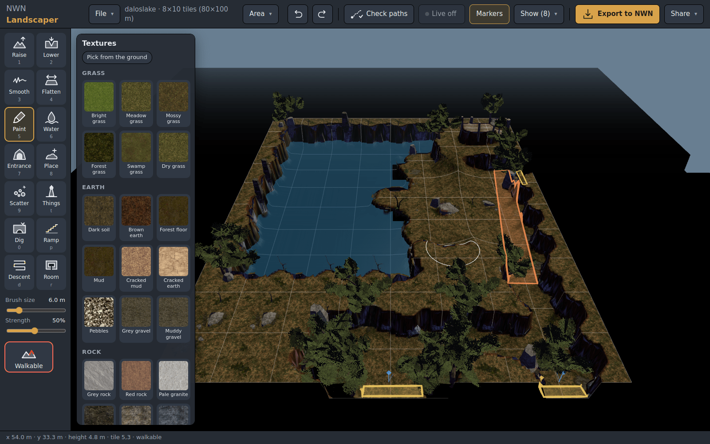

# NWN Landscaper (web editor)

Sculpt a Neverwinter Nights area in the browser and export it as an area with its own generated tileset (hak + module), checked
against NWN's pathfinding. It is for builders of NWN:EE modules. This repository is the page (three.js, no build step); the engine
that reads the game, builds the areas and serves this page is [nwn-landscaper](https://github.com/plenarius/nwn-landscaper), a separate
repository (Rust). The page talks to it over HTTP. Without the engine the page opens a blank area and only sculpting works: the
textures to paint with, saving to disk, importing, exporting, the path check, and the game's models and blueprints all come
from the engine.



What it does (*team* marks what only a team server offers, see nwn-landscaper's
[TEAM-SERVER.md](https://github.com/plenarius/nwn-landscaper/blob/master/docs/TEAM-SERVER.md)):

- **Sculpt** the ground: raise, lower, smooth, flatten; water; bottomless chasms; cave entrances; or start it from a greyscale
  heightmap image.
- **Underlay**: lay a battlemat or a map under the area, scale it by two points a known distance apart, and trace over it.
- **Paint** with a texture library the engine builds from your own game files, or pick a texture up from the ground; or paint a
  mix of several textures (grasses, sands, snow) in patches of a size you set.
- **Caves and interiors**: cut rooms and passages out of rock, ramps and descending halls, a ceiling height.
- **Things**: creatures, placeables, doors, waypoints, triggers, sounds, encounters, stores and items from the module's
  blueprints, with their tag, name, scripts and variables; your own creature and item blueprints made from existing ones.
- **Scripts and conversations**: pick scripts by name and edit them with the compiler's errors underlined as you type (on a
  team server, admins only); write conversations as a tree of lines.
- **Area settings**: name, tag, scripts, weather, music, sky and fog, as the toolset's Area Properties.
- **Import** an NWN area from the module's source or from a `.mod` or `.erf` you upload.
- **Check paths**: simulate NWN's pathfinding on random routes, after each edit or on demand, and show ground too steep to walk.
- **Export to NWN**: the hak and module, ready to play.
- **Publish**: a package (a zip) to unzip into your module's repository; with a review service, pull requests opened for review
  (*team*).
- **Try on dev**, in the Publish dialog: the area or its module on the dev server with no restart, walked in with `;forge <area>`,
  kept longer or released (*team*). New scripts can't be tried on dev: they go through Publish.
- **Save version** into the team's history, and an **Activity** log for admins (*team*).

Pull requests, the dev server, and the pictures of items and creatures need a review service: one you run yourself that answers
the calls in nwn-landscaper's [REVIEW-SERVICE.md](https://github.com/plenarius/nwn-landscaper/blob/master/docs/REVIEW-SERVICE.md).

## Install

Install the Landscaper app from nwn-landscaper's [releases](https://github.com/plenarius/nwn-landscaper/releases): an installer
for Windows (`-setup.exe`), a `.dmg` for macOS, and an AppImage or a `.deb` for Linux. It opens this editor in a window of its
own, with the engine inside it. The handbook's
[Getting started](https://landscaper.layonara.com/handbook/getting-started/) has a page for each system.

Each release also has the program alone, for the command line, a server or your own browser: an archive with the engine and this
editor in `web/` beside it. Unpack it anywhere and start `landscaper.exe` on Windows or `landscaper` on macOS and Linux; your
browser opens the editor at <http://127.0.0.1:8765/>. Close the program's window to stop it. `QUICKSTART.txt` in the archive
says what to set when it can't find the game.

To run this page from a checkout instead, see "Run" below.

## You need

- The engine, [nwn-landscaper](https://github.com/plenarius/nwn-landscaper), and what it needs: your own copy of NWN:EE and
  `nwn_gff`. Its [SELF-HOSTING.md](https://github.com/plenarius/nwn-landscaper/blob/master/docs/SELF-HOSTING.md) lists them.
  Releases of the two are tagged together: use the same `vX.Y.Z` of both. A release download has both. [CHANGELOG.md](CHANGELOG.md)
  lists what each release of this page changed.
- A browser with WebGL.

## Run

From a release download, start the program (above). From source, clone
[nwn-landscaper](https://github.com/plenarius/nwn-landscaper) next to this folder, then:

```bash
cd ../nwn-landscaper && cargo build --release
NWN_ROOT=/path/to/nwn ./target/release/landscaper serve   # http://127.0.0.1:8765/  (only on this machine)
```

`NWN_ROOT` is the game's install folder (the Steam install on Linux is found without it); `NWN_HOME` is your user folder, the
one with `hak/`, `modules/` and `tlk/`. Then open <http://127.0.0.1:8765/>. `serve` looks for this folder as `web/` beside the
program, then `nwn-landscaper-web` and `../nwn-landscaper-web` (or `landscaper-web`, this repository's earlier name) from where
you start it; or pass `--web <folder>` (or set `LANDSCAPER_WEB`). `--port` changes the port. nwn-landscaper's
[SELF-HOSTING.md](https://github.com/plenarius/nwn-landscaper/blob/master/docs/SELF-HOSTING.md) covers a team server.

### In a browser, with no engine to run

The page can also run the engine itself, built for WebAssembly, with nothing to install: nwn-landscaper's
[DESIGN-web-demo.md](https://github.com/plenarius/nwn-landscaper/blob/master/docs/DESIGN-web-demo.md). It has none of the
game's files, so it paints with the demo's own textures, and Place, Scatter, Things, Scripts and Import say they need the game.
To make that page from a checkout:

```bash
scripts/try-site.sh /tmp/try ../nwn-landscaper/target/wasm32-wasip1/wasm/landscaper.wasm ../nwn-landscaper/packs/demo
cd /tmp/try && python3 -m http.server 8000    # http://127.0.0.1:8000/
```

The engine is `landscaper.wasm` from a release's `landscaper-wasm.zip`, or built by nwn-landscaper's `scripts/build-wasm.sh`.
`try-site.sh` copies in only the editor's own files, the engine and the pack's listed pictures, and writes `try/site.json`;
`js/start.js` finds that file and starts the engine before the editor (from `landscaper serve` there is none). Then:

- `try/page.js` starts the Service Worker (`sw.js`) and a Worker of the page's own (`try/worker.js`) that runs the engine, once
  for each request, through [browser_wasi_shim](https://github.com/bjorn3/browser_wasi_shim) (`try/engine.js`). The Service
  Worker hands the editor's requests (`/api/...`, `textures/...`) to the page, which passes them to its Worker: the editor and
  the engine's HTTP interface are the same as on the desktop.
- The engine's data folder (areas, the texture library) is kept in the browser's private storage for the site (OPFS,
  `try/opfs.js`): read at the start, and what a request changed written back before its answer. Exports stay in memory. The
  first visit builds the texture library from the pack's pictures (about 2.5 s); later visits read it back.
- The engine and the stock placeables' files (`try/stock.js`) are kept in Cache Storage (`try/kept.js`), in a cache named by
  their SHA-256 in `try/site.json` (`engineSha256`, `stockSha256`): later visits ask the network for neither, since GitHub
  Pages' `max-age=600` would have the browser ask again. A new hash fetches the new files and deletes the old cache; the engine
  is kept only when its SHA-256 is right. The editor's own files stay on the HTTP cache, so a release's editor is never stale.
- File has **Download area** and **Open area from a file**, since the browser's storage is no backup; Export downloads a zip of
  the module and its haks (`try/zip.js`). The engine gets stand-ins for the few game files it reads (`try/standins.js`), made
  in code, none of them the game's.
- A link with `?area=<address>` (the handbook's showcase) opens that area file: the page fetches it, keeps it in the browser's
  storage and opens it, as **Open area from a file** would. Only files of the page's own site are fetched (`AREA_ORIGINS` in
  `js/webdemo.js`). When the browser already has an area of that name, the visitor opens theirs, or the link's under a free
  name (`lsvale2`); theirs is never replaced. `try/site.json`'s `areaLinks` tells the showcase the page can do this.
- One tab at a time: a second tab waits until the first is closed, since both would write the same files.
- Export asks for the visitor's game folder (`js/gamefolder.js`): its tiles' shaders are made from three of the game's
  files, which `try/shaders.js` reads from the game's keys and archives (the key's index and about 20 KB of shaders). They go
  to the engine for the visit only, never into the page's storage. Chromium picks the folder with its folder picker and
  remembers it; Firefox and Safari choose it in an upload field each visit. Without it the export still downloads, and says
  it won't draw right in the game.
- Areas over 16 by 16 ask first: exporting one needs more memory than a phone may have (0.4 GB at 16 by 16, 1.2 GB at 32 by
  32), and an export that runs out says the area is too big for this browser.

The page needs WebGL. Without a GPU (e.g. a remote desktop), start a separate browser window with software rendering:

```bash
google-chrome --user-data-dir=/tmp/landscaper-browser --enable-unsafe-swiftshader --ignore-gpu-blocklist http://127.0.0.1:8765/
```

## Use

- **New area**: name (1-9 of a-z 0-9 _, prefixes every resref), size in 10 m NWN tiles (3 to 32 each way), and a start. The
  starts are flat ground, gentle or rough hills, a cave or an interior (solid rock to cut rooms out of), a sample descending
  crypt, dungeon or cave, or a sample landscape: a canyon, a snowy mountain pass, a dune desert or a valley with a lake, each
  painted, lit and given its weather and sky box, and different every time. A name that an area already has asks before
  replacing that area. The engine saves your work to disk as you go; when it can't (no engine, or a failed save), the browser
  keeps the area until the engine is back and then hands it over.
- **Tools** (big buttons; the key is under each): Raise `1`, Lower `2`, Smooth `3`, Flatten `4`, Paint `5`, Water `6`, Chasm `c`,
  Entrance `7`, Light `b`,
  Place `8`, Scatter `9`, Ambience `a`, Things `t`, and for caves and interiors Dig `0`, Ramp `p`, Descent `d` and Room `r` (shown on every
  area). Brush size `[` `]`, strength slider. Left-drag sculpts; right-drag turns the view, middle-drag moves it, the wheel
  zooms; `F` reframes. Undo/redo with Ctrl+Z / Ctrl+Y.
- **Other keys**: `N` new area, `O` open, `L` sky & fog, `M` shows or hides the markers. The camera: the arrow keys move along
  the ground, Shift+arrows turn the view, `+` and `-` zoom, `Home` looks straight down.
- **A selected placeable** (Place tool): `G` moves it, `R` turns it, `S` sizes it (then the mouse or a number; click or Enter
  keeps it, Esc cancels), `Q` and `E` turn it 15°, `Delete` removes it, `Esc` deselects. A selected thing (Things tool) takes
  `Q`, `E`, `Delete` and `Esc` the same way.
- **Pick a texture up**: in the Paint tool press `I` (or the **Pick from the ground** button, or Alt-click) and click the ground. On painted
  ground it picks that texture; on an imported area it picks the tileset's own texture under the click and adds it to the library
  (under **Tileset**) the first time.
- **Texture categories**: click a category's heading in the Paint panel to fold its textures away, or use **Collapse all** and
  **Expand all**. A folded category still shows the texture you paint with, and picking a texture up opens its category. This
  browser remembers which are folded.
- **Get more textures**: the Paint panel's button lists the texture packs the engine offers, with their licence, credits and a few
  swatches. **Install** downloads one into the library (its progress shown as it goes) and its textures join their categories;
  **Remove** takes it out again, unless an area still paints with it. On a team server only admins install or remove.
- **Caves and interiors**: cut rooms and passages out of the rock with Room and Dig (passages about 6 m wide at least, along tile
  middles). Lay a Ramp between levels (a little wider than the passage), or drag a box with Descent to fill it with halls that
  step down, joined by ramps. **Area > Ceiling height** keeps the same headroom over the floor everywhere, so a descent stays tight. See
  nwn-landscaper's [BUILDER-WORKFLOW.md](https://github.com/plenarius/nwn-landscaper/blob/master/docs/BUILDER-WORKFLOW.md) for the
  rules and the limits.
- **Chasm** (`c`) opens a bottomless drop under the brush: the ground falls 20 m under its rim into the dark, and nobody walks into
  it or across it. Shift-drag fills it in again, the ground as it was; *Along the whole edge* opens one all round the area, for
  a plateau or an island over nothing. Leave a strip of ground at least 6 m wide over the middle of a tile's edge to cross one.
  For outdoor areas; it needs an engine with chasms (nwn-landscaper's `chasm` header).
- **Ambience** (`a`) places the particle pack's kinds (mist, spray, fireflies, leaves, motes, light shafts, sand, snow,
  embers, ground fog), which the export bakes into the tiles. **Fill** puts the ticked kinds where the area calls for them: mist on
  water (more where it is wide), spray where water drops, leaves under trees, fireflies on grass within 10 m of water, motes and
  shafts in gaps in the trees and at cave mouths, sand on dune crests, snow on ridges, ground fog in hollows. The brush adds the
  chosen kind; Shift-drag clears it. The panel counts the particles they keep alive by day and at night; past 1,500 it notes the
  area may be heavy on slower machines, a guide rather than a limit. The view sketches them as moving points in each kind's
  colour, night-only kinds when it shows night. It needs an engine with the particle pack (nwn-landscaper's `/api/particles`
  and `ambience` header).
- **Light** (`b`) gives the tiles under the brush two of the game's tile light colours (`lightcolor.2da`'s 32); Shift-drag
  turns them off, *Whole area* and *All off* do every tile. A tile's two lights hang over its middle and reach 14 m, so this is
  a broad wash (warm pools in a village at night, a cold glow in a cave), not a lamp: lamps stay placeables. The view draws it
  on the ground. It needs an engine with tile lights (nwn-landscaper's `lights` header).
- **Area > Import heightmap** replaces the open area's ground with a greyscale image (its top is north): the heights black
  and white stand for, stretched over the area or cropped to its shape. A 16-bit PNG is read at its full 65,536 levels; an
  8-bit image (JPEG, WebP, an 8-bit PNG) has 256, so *Smooth out steps* rounds off its terraces. Paint, water and things stay;
  Undo puts the old ground back. Not for caves and interiors.
- **Area > Underlay** lays a picture under the ground to trace over: a virtual tabletop battlemat, or a map from a book (as
  an image: PNG, JPEG, WebP, GIF or BMP, up to 16 MB). Set how see-through it is, drag it with **Move**, turn it, and size it
  with **Scale by 2 points**: click two points of the picture a known distance apart (two corners of a square) and say how far,
  in metres or feet (`5 ft`). `U` shows or hides it. The engine keeps the picture beside the area; it is never exported.
- **Walkable** (`W`) tints ground too steep for NWN creatures in red, by the same rule the exporter
  uses. The status bar shows position, height, tile and walkability under the cursor.
- **Export to NWN** builds the hak (into your NWN `hak/` folder) and module (into `modules/`, ready
  to play), then simulates NWN's pathfinding on random routes. Red markers: a route stops short.
  Orange: a tile whose walkable ground is too winding for NWN's in-tile search; straighten or widen
  the passage. A route too long for one click (NWN gives up when the way is about 20 tiles longer
  than going straight there, as across a long descent) that shorter clicks complete is not blocked:
  the report counts it apart, with how many clicks.
- **Autosave** writes each change to the engine a moment later, and at once before another area opens or the page is hidden
  (another tab, a minimised window, the tab closed or reloaded).
  A copy the engine didn't get (no engine, a failed save, a tab closed before its save finished) stays in the browser, per
  user on a team server, and goes to the engine at the next start. When the engine's copy was saved after it (another tab or
  computer), the page asks which copy to keep. So does a tab whose area another tab or computer saved since it opened it: the
  engine refuses the older tab's save, which stays in the browser until you choose.
- **File, Delete area** deletes the area open, after asking: it leaves your areas with its export, and the page opens your
  newest other area. The engine keeps its last copy (nwn-landscaper's
  [TEAM-SERVER.md](https://github.com/plenarius/nwn-landscaper/blob/master/docs/TEAM-SERVER.md#deleted-areas), "Deleted areas", says
  how to bring it back); the module it was exported into and its hak stay.

## Development

There is no build step: edit the files and reload the page. `scripts/check.sh` runs every check the way CI does (Biome,
html-validate, spelling, writing, Markdown, links, licences, secrets); [STYLE.md](STYLE.md) is the standard it checks.

A changelog entry is a file of its own in `changelog.d/`, not an edit to CHANGELOG.md, so pull requests don't conflict
there ([CONTRIBUTING.md](CONTRIBUTING.md)). A release's pull request folds them into the version's section with
`scripts/changelog.sh release X.Y.Z`, as the engine's does; the engine's README ("Releases") has the rest of a release.
Between releases the editor says `+dev` after the last release's version beside its title while `changelog.d/` holds an entry
(the engine lists them at `/changelog.d/`) or CHANGELOG.md starts with `## Unreleased`.

A change a builder sees also updates the handbook page that covers it, in nwn-landscaper's `docs/handbook/`: a pull request
there, linked from this one ([CONTRIBUTING.md](CONTRIBUTING.md)).

`node --test 'tests/*.test.js'` (Node 24) runs the tests, without a browser: `tests/browser.js` gives the page's modules a
stand-in for the page, the browser's storage and the engine, and swaps the modules that draw or ask for the stubs in
`tests/stubs/`; `tests/importmap.js` resolves the vendored packages through `index.html`'s import map, as the browser does.

Two rules of this repository's own, as Biome plugins in `lint/`:

- Data goes into the page as text: build elements with `el()` from `js/dom.js`, `textContent` or `new Option()`.
  `innerHTML` and its relatives take only a fixed string. Area files, the engine's answers and the browser's storage hold
  text that builders typed, and an admin opens builders' areas.
- Every request to the engine goes through `api()` in `js/api.js`, which sends the `X-Landscaper: 1` header the engine
  checks. Another site's page can't send that header, so the engine can refuse requests that don't carry it.

In the desktop app (the engine's
[DESIGN-desktop-app.md](https://github.com/plenarius/nwn-landscaper/blob/master/docs/DESIGN-desktop-app.md)) the window opens
the editor at `/?app`, which `js/desktop.js` reads. There the page shows no "How to start the engine" link, says to restart the
app when its engine stops answering, and has a Help menu (the handbook, the data folder, the log) and Area, Game folders….
Each of those items sends `POST /api/app/open` with `{"what": "data"}`, `"log"` or `"folders"` to the engine inside the app,
which opens the folder or the log with the system, or shows the app's page for the game's folders, and answers 204 (else
`{ "error" }`). The version menu offers the app's updates (`js/update.js`): `GET /api/app/update` says what the app's updater
found, and "Update to X.Y.Z" shows the release notes and asks before `POST /api/app/update` installs it.
`KEEP_BUFFER_ON_MAC` in `js/desktop.js` keeps the 3D view's drawing buffer in the app on macOS, if a real Mac shows the view
empty without it.

`tests/lint.test.js` runs each plugin on its fixture in `lint/fixtures/` (with `biome` on the PATH): the lines marked
`// flagged` must be found and no others, so a pattern that stops matching after a Biome upgrade fails the tests.

`index.html` carries a Content-Security-Policy: only the page's own files run, the import map is allowed by its SHA-256, and
requests go to the page's own server. A change to the import map changes that hash; Chrome's console then names the hash
it expected, which goes into the policy. The engine reads this `<meta>` and sends the same policy as a header (adding
`frame-ancestors 'none'`), so the `<meta>` is the one place to change it.

## Credits

Forked from [ergin3d/heightmap-generator](https://github.com/ergin3d/heightmap-generator) (MIT), which supplied the three.js
view, raycast painting, brush falloff, noise and filters. The UI and data model are rebuilt around NWN areas; `js/noise.js` is
still ergin3d's file.

Vendored, unmodified, each with its own `LICENSE`:

- `vendor/three`: [three.js](https://threejs.org/) r186 (npm `three` 0.186.1: `build/three.module.js`, the
  `build/three.core.js` it imports, and `examples/jsm/controls/OrbitControls.js`), MIT.
- `vendor/simplex-noise`: [simplex-noise](https://github.com/jwagner/simplex-noise.js) 4.0.3 (`dist/esm/simplex-noise.js`), MIT.
- `vendor/browser_wasi_shim`: [browser_wasi_shim](https://github.com/bjorn3/browser_wasi_shim) 0.4.2 (npm
  `@bjorn3/browser_wasi_shim`, `dist/`), MIT or Apache-2.0: runs the engine's WebAssembly in the page in the browser.
- `vendor/codemirror`: [CodeMirror](https://codemirror.net/) 6 for the script editor, all MIT. It is one file that esbuild 0.28.2
  bundled from `codemirror` 6.0.2, `@codemirror/view` 6.43.15, `@codemirror/state` 6.7.6, `@codemirror/lint` 6.9.7,
  `@codemirror/lang-cpp` 6.0.3 and `@codemirror/theme-one-dark` 6.1.3, with the packages they pull in.
  [vendor/codemirror/README.md](vendor/codemirror/README.md) lists every version and how to rebuild it.

## Licence

MIT: see [LICENSE](LICENSE). Copyright (c) 2026 ergin3d and (C) 2026 plenarius. The vendored packages keep their own licences
(all MIT), recorded in [REUSE.toml](REUSE.toml).
