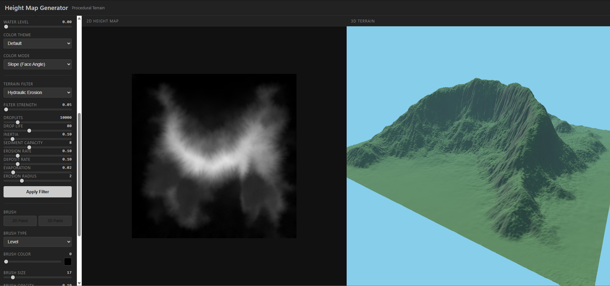

# Height Map Generator

A browser-based procedural terrain generator with real-time 2D and 3D visualization. Generate, sculpt, filter, and export height maps — no build tools, no server, no dependencies to install.

**Live Demo:** [https://heightmap-generator.netlify.app/](https://heightmap-generator.netlify.app/)



> Vibe coded with [Claude](https://claude.ai) by Anthropic

## Features

### Terrain Generation
- **Fractal noise** (Simplex) with full parameter control: seed, octaves, persistence, lacunarity, scale
- **Pan X/Y** to explore different regions of the infinite noise field
- **Black/White levels** to remap height range and control contrast
- **Terrain presets**: Rolling Hills, Sharp Peaks, Archipelago, Plateaus, Gentle Dunes, Alpine

### Brush Painting
- **2D painting** directly on the height map canvas
- **3D painting** directly on the terrain mesh via raycasting
- **Three brush types**:
  - **Paint** — raise/lower terrain with a greyscale color picker
  - **Smooth** — blur and soften terrain under the brush
  - **Level** — flatten area to the height sampled at the click point
- **Brush controls**: size (up to 150px), opacity, pressure, feather (soft edges with up to 4x radius extension)

### Terrain Filters
- **Smooth** — Gaussian-like blur with multiple passes
- **Sharpen** — enhance edges and fine detail
- **Thermal Erosion** — material flows downhill from steep slopes (configurable iterations, talus angle, sediment transfer, radius)
- **Hydraulic Erosion** — particle-based water simulation that carves realistic river channels (configurable droplets, drop life, inertia, sediment capacity, erosion/deposit rates, evaporation)
- **Terrace** — quantize heights into stepped plateaus
- **Ridged** — transform smooth hills into sharp ridgelines
- **Add Noise** — overlay fractal simplex noise with its own seed, octaves, scale, persistence, lacunarity
- **Invert** — flip valleys and peaks
- **Clamp Extremes** — reduce extreme highs and lows
- **Normalize** — stretch height range to fill full 0-1

All filters have a strength slider and can be applied multiple times for stacking effects.

### 3D Visualization
- **Interactive orbit controls** — rotate, zoom, pan the 3D terrain
- **8 color themes**: Default, Snowy Peaks, Desert, Volcanic, Arctic, Tropical, Greyscale, Mars
- **3 color modes**:
  - **Height** — colors based on elevation
  - **Slope (Face Angle)** — colors based on surface steepness (flat = grass, steep = rock)
  - **Blend** — combines height and slope for realistic results
- **Real-time updates** as you adjust parameters
- Height multiplier and water level controls

### Import / Export
- **Export PNG** — download the height map as a greyscale image
- **Load Height Map** — import any image as terrain (converted to greyscale via luminance)

## Quick Start

No installation required. Just serve the files:

```bash
# Option 1: npx (Node.js)
npx serve .

# Option 2: Python
python -m http.server 3000

# Option 3: Open index.html directly (may have CORS issues with ES module imports)
```

Then open `http://localhost:3000` in your browser.

## Project Structure

```
index.html          HTML layout, CSS, CDN import maps
js/
  main.js           Orchestrator — wires UI, brush, and render pipeline
  noise.js          Seeded simplex noise + fractal Brownian motion
  heightmap.js      2D canvas rendering + PNG export
  terrain3d.js      Three.js scene, camera, lighting, terrain mesh, color palettes
  brush.js          2D and 3D brush painting with paint/smooth/level modes
  filters.js        All terrain filters (erosion, smooth, sharpen, noise, etc.)
  ui.js             Slider bindings, presets, parameter management
```

## Tech Stack

- **Three.js** (v0.170) — 3D rendering via CDN
- **simplex-noise** (v4.0.3) — noise generation via CDN
- **Vanilla JS** — ES modules, no framework, no build step
- **CSS Grid** — responsive layout

## Browser Support

Works in all modern browsers with WebGL support (Chrome, Firefox, Edge, Safari).

## License

MIT
